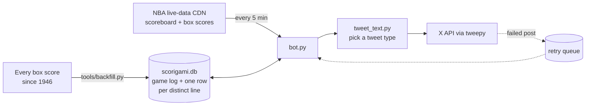

# NBAgami

An X (Twitter) bot that watched every NBA game during the 2025–26 season and posted when a player put up a points / rebounds / assists line that had **never happened before in NBA history**: a "Ballgami," borrowing the idea of [Scorigami](https://en.wikipedia.org/wiki/Scorigami) from football scores.

When nobody hit a new line, it posted the night's top line with context on how rare it was: who did it last, whether it was a near miss, or whether a legend owns the same numbers.

```
🚨 BALLGAMI ALERT 🚨

History has been made. Nikola Jokic just recorded 34 PTS / 21 REB / 12 AST.

This is the FIRST time this stat line has ever happened in the history of the NBA.
```

## The data

The bot's memory is every player's line from every NBA game since the league's first season:

| | |
|---|---|
| Player game lines | **1,642,727** (November 1946 to December 30, 2025) |
| Players | 5,512 |
| Distinct points / rebounds / assists lines | **17,035** |
| Lines that have happened exactly once | 4,302 |
| New Ballgamis in the 2025–26 season, through December 30 | 28 |
| Highest-scoring line | 100 / 25 / 2, Wilt Chamberlain, March 2, 1962 |

Some of the season's Ballgamis, straight from `tools/season_ballgamis.py`:

```
DATE         | PLAYER                    | PTS REB AST
------------------------------------------------------
2025-12-28   | Kawhi Leonard             | 55  11  2
2025-12-27   | Nikola Jokic              | 34  21  12
2025-12-26   | Cade Cunningham           | 29  5   17
2025-12-25   | Nikola Jokic              | 56  16  15
2025-12-23   | Jamal Murray              | 31  7   14
2025-12-23   | Josh Giddey               | 19  11  15
2025-12-22   | Nikola Jokic              | 14  13  13
2025-12-18   | Luka Doncic               | 45  11  14
2025-12-18   | Jalen Johnson             | 43  11  9
2025-12-12   | Donovan Mitchell          | 48  4   4
```

## How it works



1. **History:** `tools/backfill.py` loads the full box-score CSV with pandas, then collapses it into one row per distinct points/rebounds/assists line, recording how often it happened and who did it first and last. Everything goes into SQLite.
2. **Live games:** `bot.py` runs every five minutes on GitHub Actions. It reads the NBA's public live-data CDN for games that have finished, pulls each box score, skips players who didn't play, and checks every line against the database. The game day rolls over on US Eastern time, so late West Coast games still count toward the right date.
3. **Choosing what to say:** for each game, a new line wins. Otherwise the top scorer's line is classified in priority order and rendered from the matching template in `templates.txt`.
4. **Posting:** one tweet per game through the X API. Failed posts go into a retry queue with a cooldown so a rate limit doesn't lose a tweet, and processed games are recorded so a rerun never double-posts.

## The tweet types

| Type | When it fires | Share of tweets* |
|---|---|---|
| Ballgami | The line has never happened before | 4.3% |
| Near miss | One more or one fewer point, rebound or assist would have been new | 6.3% |
| Legendary | The player, or the last person to post the line, is a retired star | 2.1% |
| Time traveler | Nobody's done it since before 2000 | 1.0% |
| High volume | A 40-point night that still isn't new | 6.3% |
| Triple-double | A triple-double that isn't new | 0.7% |
| Déjà vu | Someone posted the same line in the last 10 days | 4.6% |
| Common | It's happened more than 150 times | 12.1% |
| Rare | It's happened 10 times or fewer | 9.6% |
| Default | Everything else | 53.0% |

\*From `tools/tweet_mix.py`, which replays the top five lines of each recent game day through the same classifier the bot uses. Across those 1,000 simulated tweets, 188 different players were featured.

Jokic's 56 / 16 / 15 on Christmas was a Ballgami. If anyone matched it the next night, the bot would call it a near miss, since 57 points would still have been new:

```
SO CLOSE to a Ballgami! 🤏
Nikola Jokic finished with 56 PTS / 16 REB / 15 AST.

If he had recorded just one more point, it would have been a unique line. Instead, he becomes the 2nd person to hit this mark.
```

And an everyday line:

```
Stephen Curry had 31 PTS / 4 REB / 6 AST tonight.

Not a ballgami ❌

He joins 43 other players to record this exact stat line with the most recent being Julius Randle on 2025-10-26.
```

## Tools

| Script | What it does |
|---|---|
| `tools/backfill.py` | Rebuild the history database from the box-score CSV (about 10 seconds for 1.6 million rows) |
| `tools/search.py` | Look up every time a stat line has happened |
| `tools/preview_tweet.py` | Show the tweet the bot would write for any line |
| `tools/season_ballgamis.py` | List every first-ever line recorded this season |
| `tools/tweet_mix.py` | Replay recent games to see how often each tweet type would fire |

```
$ python tools/search.py
--- 🏀 NBA Stat Line Search 🏀 ---
Points (PTS): 40
Rebounds (REB): 10
Assists (AST): 10

🔎 Searching for 40/10/10...
✅ Found 3 instances:
 - James Harden (2017-03-18)
 - LeBron James (2005-04-09)
 - Chris Webber (1995-12-27)
```

## Run it

```bash
pip install -r requirements.txt
python tools/backfill.py         # needs player_stats.csv (full NBA box-score history)
python bot.py --test             # dry run for today: prints tweets instead of posting
python bot.py --test 2026-01-05  # dry run for a past date
```

To post for real, copy `.env.example` to `.env` and add X API credentials. The GitHub Actions workflow reads the same four values from repository secrets.

The database and source CSV aren't in the repo (the CSV is over 300 MB). The bot is retired, so the workflow is now manual-only.

## License

MIT, see [LICENSE](LICENSE).
